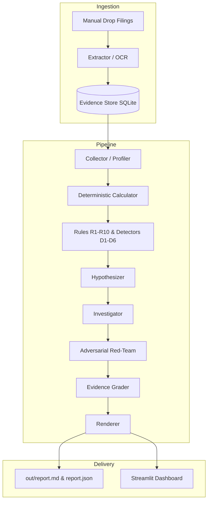

# finTrance

Evidence-first forensic research agent for Indian banking and NBFC public disclosures.

> [!IMPORTANT]
> **Honesty Note**: No real-data runs exist in this repository. Real company findings remain **PENDING** until public filings are placed under `store/manual_drop/<ticker>/`. All demonstration numbers, evaluations, and example outputs are **SYNTHETIC**. The checked-in exchange endpoints in `config/sources.yaml` are intentionally unconfigured pending verified captures. This project never fabricates symbols, numbers, quotes, or findings.

---

## Overview

| Dimension | Details |
|---|---|
| **Task** | Track A, ATMOS 2026: *"Finding the Next Signal"* (Forensic financial disclosure research) |
| **Target Sector** | Indian commercial banks and NBFCs (`bank`, `nbfc`, `housing_fin`, `other_fin`) |
| **Agent Core** | 10-stage evidence-bound pipeline from raw filing ingestion to graded forensic report |
| **Inputs** | Unstructured public filings (PDF, HTML, XLSX) under `store/manual_drop/<ticker>/` or structured CSV facts |
| **Outputs** | 8-element rendered forensic reports in Markdown (`report.md`) and JSON (`report.json`), run logs (`run_log.json`), and Streamlit dashboard |
| **Mode** | Fully deterministic offline no-LLM mode by default; provider-neutral structured JSON LLM boundary optional |

---

## The 8 Required Output Elements

1. **Discovery**: Core anomaly or pattern finding statement backed strictly by stored evidence.
2. **Why It Matters**: Grounded explanation of operational significance and research context without investment advice.
3. **Evidence**: Tabular register of verbatim quotes, document IDs, page numbers, and support roles.
4. **Timeline**: Chronological progression of observed disclosures, anomalies, and structural events.
5. **Numbers**: Provenance-linked metrics and financial values with exact units and reporting basis.
6. **Counterargument**: Adversarial red-team challenge identifying confounding or benign explanations.
7. **Falsification Condition**: Concrete quantitative conditions or future quarters that refute the hypothesis.
8. **Evidence Strength**: Transparent score (0–10) and rubric label (`Strong`, `Moderate`, `Weak`).

---

## Example Output

> **Note:** The following block is generated from a **SYNTHETIC** demonstration run (`py run_demo.py --synthetic --no-app`).

```markdown
# Discovery

A configured metric relationship decoupled.

## Why it matters
- This is a research signal, not an investment recommendation.
- The evidence window and limitations are shown explicitly.

## Evidence

| Document | Page | Quote |
|---|---:|---|
| 6f0348a2477101cf | 1 | SYNTHETIC gross_advances 1953.125 |
| 6f0348a2477101cf | 1 | SYNTHETIC stage3_assets 156.25 |
| 6f0348a2477101cf | 1 | SYNTHETIC gross_advances 4768.37158203125 |
| 6f0348a2477101cf | 1 | SYNTHETIC stage3_assets 745.0580596923828 |

## Numbers
- gross_advances=1953.125 INR crore
- stage3_assets=156.25 INR crore

## Counterargument
The pattern may reflect a sector-wide effect or denominator change.

## Falsification condition
Two consecutive quarters below the rule threshold would refute this pattern.

## Why this is not obvious
management=1.0; headline_obviousness=1.0; peer_uniqueness=n/a

## Evidence strength
Weak (3/10) [persistence: +2, primary_source: +1, stability: +1]
```

---

## Quick Start

Python 3.11+ is required (3.13 recommended).

### Option A: One-Command Launcher

```bash
# Dry run: validates preflight and displays run plan without filesystem changes
python run_demo.py --dry-run

# Run labelled SYNTHETIC demo without launching browser
python run_demo.py --synthetic --no-app

# Run all verification checks (pytest, ruff, name guard, secrets, artifacts)
python run_demo.py --check

# Standard launch with UI (defaults to port 8501 or next free port)
python run_demo.py
```

**Launcher flags:**
- `--company <name>`: Target specific company by name.
- `--ticker <symbol>`: Target specific ticker folder.
- `--peers <p1,p2>`: Override peer tickers for comparative analysis.
- `--all`: Process all discovered company folders in `store/manual_drop/`.
- `--reingest`: Force re-extraction of previously processed filings.
- `--no-app`: Headless CLI run (skips Streamlit UI launch).
- `--check`: Run test suite, linter, name guard, secret scan, and artifact checks.
- `--synthetic`: Run isolated offline synthetic demonstration when no filings exist.
- `--dry-run`: Display execution plan without making any disk writes or network calls.
- `--port <int>`: Preferred Streamlit port (default: 8501).
- `--time-budget <sec>`: Pipeline timeout per company in seconds (default: 120s).

### Option B: Step-by-Step Commands

| Step | Command | Description |
|---|---|---|
| **Setup** | `pip install -e ".[dev]"` | Install package with development dependencies |
| **Config** | `cp .env.example .env` | Create environment file (keys optional; defaults to `--no-llm`) |
| **Ingest** | `python -m agent.cli ingest --company <TICKER>` | Ingest filings from `store/manual_drop/<TICKER>/` |
| **Audit** | `python -m agent.cli facts audit --ticker <TICKER>` | Verify stored quotes match source documents verbatim |
| **Run** | `python -m agent.cli run --company <TICKER> --no-llm` | Execute 10-stage evidence pipeline in deterministic mode |
| **Dashboard** | `streamlit run app/main.py` | Launch interactive evidence and report exploration UI |
| **Tests** | `pytest` | Execute 294 unit and regression tests |
| **Checks** | `ruff check .` | Run static linting and formatting validation |

---

## Adding Data

Place official public documents under `store/manual_drop/<ticker>/`.

1. **Obtaining Documents**: Use official sources only (e.g., BSE/NSE announcements, company investor relations, annual reports). Supported extensions: `.pdf`, `.html`, `.htm`, `.xlsx`.
2. **Directory Naming**: Group documents by ticker symbol:
   ```text
   store/manual_drop/
   └── <TICKER>/
       ├── Q1FY25_results.pdf
       ├── Q2FY25_presentation.pdf
       └── FY24_annual_report.xlsx
   ```
3. **Company Metadata (`data/universe.csv`)**: Optionally copy `data/universe.example.csv` to `data/universe.csv` to configure peer groups:
   ```csv
   ticker,name,type,peers
   HDFCBANK,HDFC Bank,bank,"ICICIBANK,KOTAKBANK"
   ```
4. **CSV Fact-Import Fallback**: When filings cannot be parsed automatically, import facts with [docs/FACTS_CSV.md](docs/FACTS_CSV.md):
   ```bash
   python -m agent.cli facts import --file facts.csv
   ```
   Requires `ticker,metric,period,value,unit,source_file,page,quote`. Facts with unregistered sources are marked `manual_unverified`.

---

## Architecture



- **Collector**: Resolves company metadata, peer sets, and profile types (`bank`, `nbfc`, etc.) without fabricating missing endpoints.
- **Extractor**: Extracts quotes and tables from PDF, HTML, and XLSX, enforcing verbatim quote matching against source pages.
- **Evidence Store**: SQLite DAO storing immutable documents, validated facts, runs, and provenance links.
- **Calculator**: Computes deterministic financial metrics (GNPA %, PCR, slippages, credit costs, funding HHI, CASA ratio) with strict provenance.
- **Scanner**: Evaluates domain rules (R1–R10) and open-ended anomaly detectors (D1–D6) over quarterly time series.
- **Hypothesizer**: Formulates structured candidate explanations linking observed anomalies to business drivers.
- **Investigator**: Searches the stored document corpus for corroborating and contradicting verbatim disclosures.
- **Red-Team**: Adversarially challenges hypotheses against sector trends, denominator artifacts, and accounting policy changes.
- **Grader**: Computes an objective 0–10 evidence strength score using a deterministic multi-factor rubric.
- **Renderer**: Produces the final 8-element report in Markdown and JSON, suppressing unbacked claims.

---

## Analysis Coverage

### Domain Rules (`config/anomaly_rules.yaml`)

| Rule | Angle | Description |
|---|---|---|
| **R1** | Growth vs Stress | Loan growth > 20% while stress indicators outpace growth by > 2.0x for >= 4 quarters. |
| **R2** | Cosmetic GNPA | Reported GNPA % declines while write-off-adjusted GNPA rises and write-offs exceed 10%. |
| **R3** | Provisioning Lag | Credit costs fall while underlying stress indicators rise for >= 2 consecutive quarters. |
| **R4** | Coverage Erosion | Provision Coverage Ratio (PCR) drops > 5% over 6 quarters without GNPA improvement. |
| **R5** | Funding Mix Shift | Any funding category share shifts by > 10% over an 8-quarter rolling window. |
| **R6** | CASA Decline | Low-cost CASA deposit share declines by > 5% over 4 quarters. |
| **R7** | Funder Concentration | Funding Herfindahl-Hirschman Index (HHI) > 0.25 or top lender share > 25%. |
| **R10**| Short-Term Reliance | Commercial paper / short-term share rises > 5% QoQ during rapid loan growth (> 20%). |

*Note: R8 and R9 are reserved in schema taxonomy and omitted from current rule activation.*

### Open-Ended Detectors (`config/open_ended.yaml`)

| Detector | Angle | Description |
|---|---|---|
| **D1** | Robust Outlier | Rolling Median Absolute Deviation (MAD) z-score > 3.5 over a 4-quarter window. |
| **D2** | Relationship Break | Decoupling of historically correlated metric pairs over 4 consecutive quarters. |
| **D3** | Peer Divergence | Company metric trajectory slope diverges from peer median slope by > 0.1 over 6 quarters. |
| **D4** | Mix Shift | Category distribution shifts > 10 percentage points across an 8-quarter window. |
| **D5** | Unexplained Break | CUSUM statistical change-point occurring without an explanatory corporate event. |
| **D6** | Disclosure Drift | Appearance of high-risk terms (e.g., *moratorium*, *ECL overlay*, *restructured*) absent in prior filings. |

### Evidence-Strength Rubric (`agent/reason/grade.py`)

| Rubric Criterion | Point Value | Condition |
|---|---:|---|
| Independent Documents | **+3** | >= 3 independent source documents backing finding |
| Source Types | **+2** | >= 2 distinct source types (e.g., exchange filing + annual report) |
| Persistence | **+2** | Pattern persists for >= 4 consecutive quarters |
| Peer Check | **+2** | Divergence verified against peer group |
| Primary Source | **+1** | Backed by primary statutory filings |
| Detector Agreement | **+1** | Multiple independent detectors flag anomaly |
| Stability | **+1** | Anomaly survives perturbation sensitivity testing |
| Unresolved Counterargument | **-3** | Red-team counterargument remains unrefuted |
| Source Gaps / Low Confidence | **-2** | Missing periods, OCR degradation, or unverified quotes |
| Structural Break Overlap | **-2** | Coincides with merger, acquisition, or accounting reclassification |

**Grading Scale**: **Strong**: >= 8 pts | **Moderate**: 4–7 pts | **Weak**: < 4 pts.

---

## Design Principles

- **Generic by Company Type**: Metric formulas, thresholds, and preferred accounting basis (standalone for banks, consolidated for NBFCs) adapt dynamically via configuration.
- **Evidence-First**: No fact exists without an immutable document reference, page index, and verbatim quote. Unsupported discoveries are suppressed.
- **Deterministic Numbers**: All financial computations use transparent, auditable math with zero LLM hallucinations.
- **Adversarial Red-Team**: Every candidate finding must undergo explicit counterargument checks for sector-wide trends and denominator effects.
- **Graceful Degradation**: When public files or endpoints are missing, the system reports exact coverage gaps rather than inventing data.

---

## Security

Controls enforced across the codebase (see [SECURITY.md](SECURITY.md)):
- **Secret Scanning**: `scripts/scan_secrets.py` scans working tree and git history for API keys.
- **SSRF & Network Guard**: Strict HTTPS enforcement, domain allowlist (`config/security.yaml`), request timeouts, response limits (20 MB), and private IP blocking.
- **Input Sanitization**: File paths restricted to repository roots; untrusted documents treated as data, never instructions.
- **Artifact Hygiene**: Tracked repository status verified via `scripts/check_artifacts.py`.
- **Company Name Guard**: `scripts/check_no_company_names.py` ensures no proprietary or target entities are hardcoded.

---

## Testing and Evaluation

- **Test Suite**: **294 passing tests** covering unit calculations, DAO, ingestion, validators, detectors, red-teaming, and security.
- **CI Workflow**: Runs pytest, Ruff, company-name check, and secret scans on every push and PR.
- **Synthetic Smoke Evaluation** (`scripts/eval_synthetic.py`):

| Case | Injected | Detected |
|---|---:|---:|
| SYNTHETIC robust outlier | True | True |
| SYNTHETIC funding-mix shift | True | True |
| SYNTHETIC relationship break | True | True |
| SYNTHETIC structural-break decoy | False | False |
| SYNTHETIC restatement decoy | False | False |
| SYNTHETIC pure noise | False | False |

**Performance**: `SYNTHETIC recall=3/3 (100%); false_positives=0/3 (0%)`.
*Limitation: All test cases are synthetic. This evaluates detector mechanics, not real-world market efficacy.*

---

## Repository Structure

```text
finTrance/
├── .env.example
├── .github/workflows/ci.yml
├── README.md
├── SECURITY.md
├── pyproject.toml
├── run_demo.py
├── agent/
│   ├── calc/          # Deterministic metric, break, and funding math
│   ├── collector/     # Network-bounded source adapters
│   ├── extractor/     # PDF, HTML, XLSX parser with quote verification
│   ├── reason/        # Hypothesize, investigate, red-team, grader
│   ├── render/        # Markdown & JSON report formatting
│   ├── scan/          # Rules R1-R10, detectors D1-D6, novelty scoring
│   ├── cli.py         # Subcommand CLI interface
│   ├── ingest.py      # Ingestion pipeline & coverage matrices
│   └── orchestrator.py# 10-stage end-to-end execution pipeline
├── app/
│   └── main.py        # Streamlit evidence exploration dashboard
├── config/            # Anomaly rules, detectors, metrics, and security YAMLs
├── data/
│   └── universe.example.csv # Peer universe template
├── docs/              # Data source verification, CSV import specs, capture guide
├── scripts/           # Secrets scanner, name guard, synthetic eval, artifact check
├── store/             # SQLite evidence DAO and manual_drop storage root
└── tests/             # 294 automated unit and integration tests
```

---

## Limitations

- **Public Data Only**: Dependent on public disclosure clarity; cannot observe private banking books or off-balance-sheet items.
- **Extraction Fragility**: Complex multi-column financial statements or scanned image tables may require OCR or manual CSV template entry.
- **Synthetic Evaluation**: Benchmark metrics represent synthetic unit tests; no real-world financial accuracy claim is made.
- **No Causal Claims**: Discovered anomalies represent statistical and accounting divergences, not definitive proof of management misconduct or fraud.

---

## Troubleshooting

| Error Message / Symptom | Root Cause | Resolution |
|---|---|---|
| `Python 3.11 or newer is required.` | Python runtime version is < 3.11. | Upgrade your environment to Python 3.11, 3.12, or 3.13. |
| `No company folders found under store/manual_drop/...` | No filings deposited in manual drop directory. | Place filings in `store/manual_drop/<ticker>/` or run with `--synthetic`. |
| `Port 8501 is busy; using port <port>.` | Default Streamlit port is occupied. | Informational; launcher automatically selects next free port. |
| `No LLM key configured; using --no-llm deterministic mode.` | Missing API key in environment or `.env`. | Informational; pipeline runs safely in full offline deterministic mode. |
| `OCR unavailable / skipped image-only pages` | Tesseract binary not detected on system path. | Install Tesseract OCR (UB Mannheim build on Windows, `apt install tesseract-ocr` on Linux) or rely on digital PDFs. |

---

## Team & Roadmap

### Team
- **Team Name**: FinTrance
- **Members**: Kumuda Sri Padmanabhuni, Hamsini Chowdary Daruvari, W Sameeksha, Gargee Joshi

### Roadmap
- **P0**: Core evidence foundation, DAO, deterministic calculations, and manual drop ingestion. *(Completed)*
- **P1**: Funding mix angles, Streamlit evidence dashboard, and presentation break tracking. *(Completed)*
- **P2**: Open-ended detectors (D1–D6), novelty ranking, and runner-up hypothesis evaluation. *(Completed)*
- **P3**: Multi-company batch testing, expanded cache layer, extraction speed profiling, and real-data endpoint captures. *(In Progress)*

---

## Disclaimer

*finTrance is a research prototype for algorithmic disclosure analysis. It provides informational signals only and does not provide investment, legal, accounting, or financial advice. All examples in this repository use synthetic demonstration data.*
